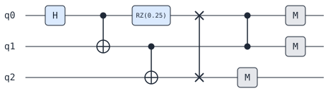

# helioq

A small quantum computing library, written from scratch to understand every
layer of a quantum software stack: how circuits are represented, how they are
simulated, how compilers rewrite them, and how they are exported.

This is a learning project, not a replacement for Qiskit or PennyLane. The
goal is that every line can be explained.

## Roadmap

| Layer | Module | Milestone |
|---|---|---|
| 1. Circuit representation | `helioq.circuit` | Build a Bell-state circuit |
| 2. State-vector simulator | `helioq.simulator` | Bell and GHZ states match the textbook amplitudes |
| 3. Optimization passes | `helioq.passes` | Cancel inverse pairs; merge single-qubit gates into U3 |
| 4. Export | `helioq.qasm` | Output OpenQASM 2.0 that Qiskit can load |
| 5. MPS simulator | `helioq.mps` | Simulate 30+ qubits of a low-entanglement circuit |

Status: layer 1 done. Layer 2 is next: `tests/test_simulator.py` is its
specification.

## Fault-tolerance track

A second track that does not depend on layers 2–5:

| Module | What it does |
|---|---|
| `helioq.draw` | Text and SVG circuit diagrams: `circ.draw()`, `circ.to_svg()` |
| `helioq.stabilizer` | Tableau simulator for Clifford circuits, with measurement, reset and Pauli noise |
| `helioq.qec` | Repetition, Steane and rotated surface codes; syndrome circuits; lookup decoder; logical error rates |

```python
from helioq import Circuit
from helioq.stabilizer import run, stabilizers

bell = Circuit(2).h(0).cx(0, 1)
print(bell.draw())
# q0: ─H──●─
#         │
# q1: ────⊕─
stabilizers(bell)  # ['+XX', '+ZZ']
run(bell.measure_all(), shots=4, seed=0)  # rows are 00 or 11, never 01 or 10
```



```python
from helioq.qec import memory_experiment, rotated_surface_code

exp = memory_experiment(rotated_surface_code(3), p=0.03)
exp.logical_error_rate(shots=2000, seed=0)  # about 0.005
exp.logical_error_rate(shots=2000, seed=0, decode=False)  # about 0.06
```

`python examples/repetition_code_threshold.py` prints logical error rate
against physical error rate for several code distances.

Not there yet: noisy gates and measurements (circuit-level noise), detectors
over many rounds, a matching decoder, logical gates.

Design decisions are recorded in [`docs/design.md`](docs/design.md).

## Development

```bash
pip install -e ".[dev]"
pytest
ruff check . && ruff format .
```
